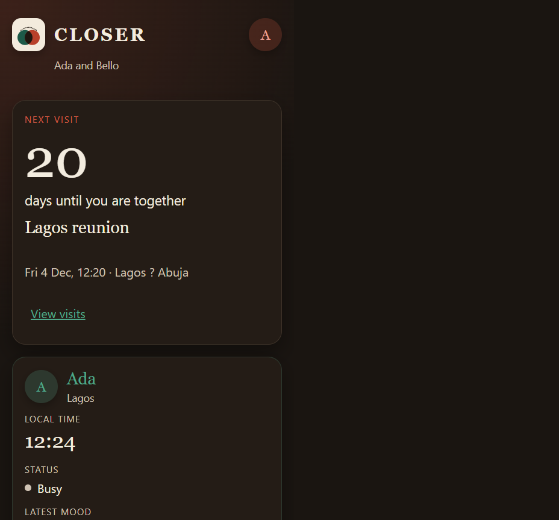
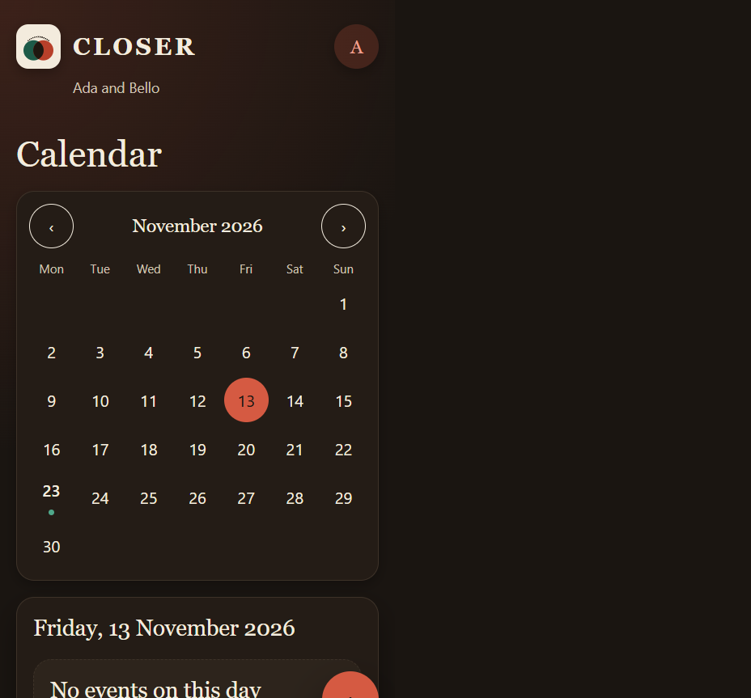
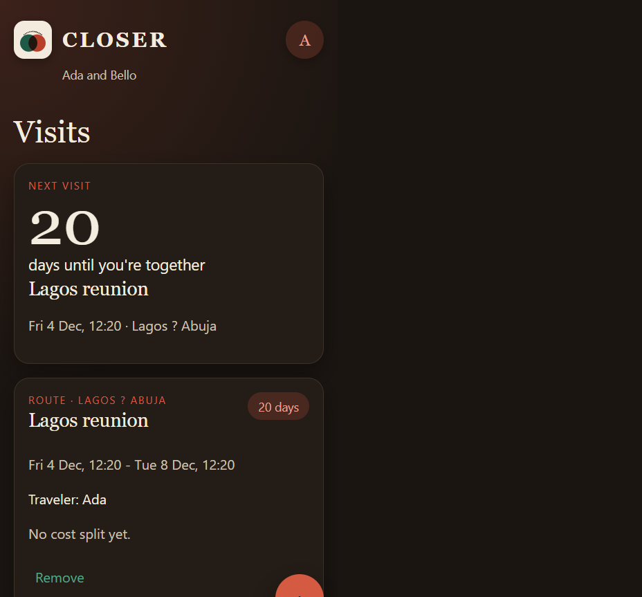
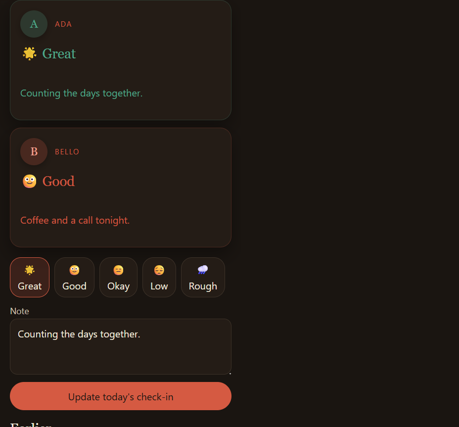
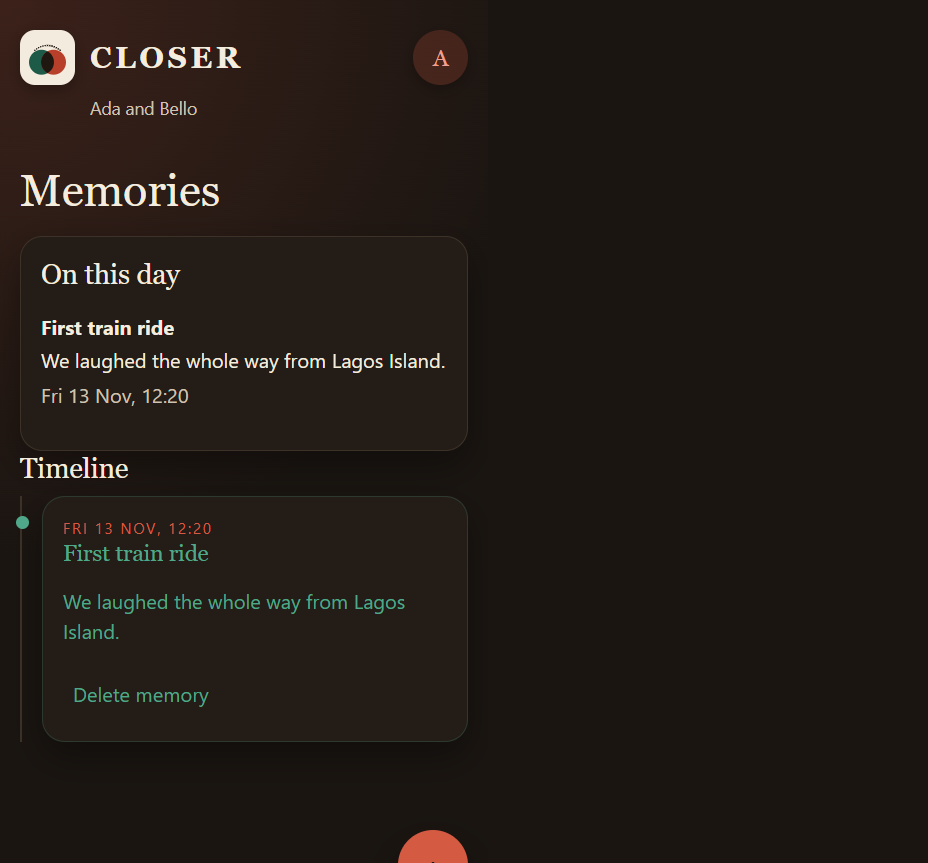
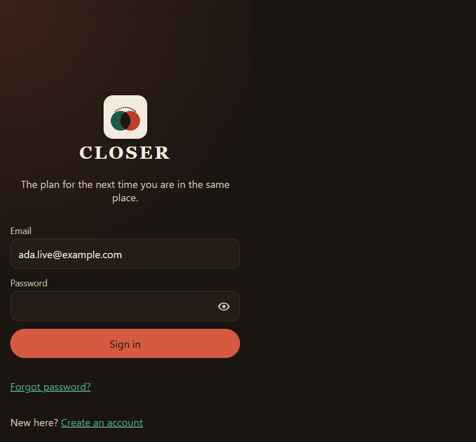
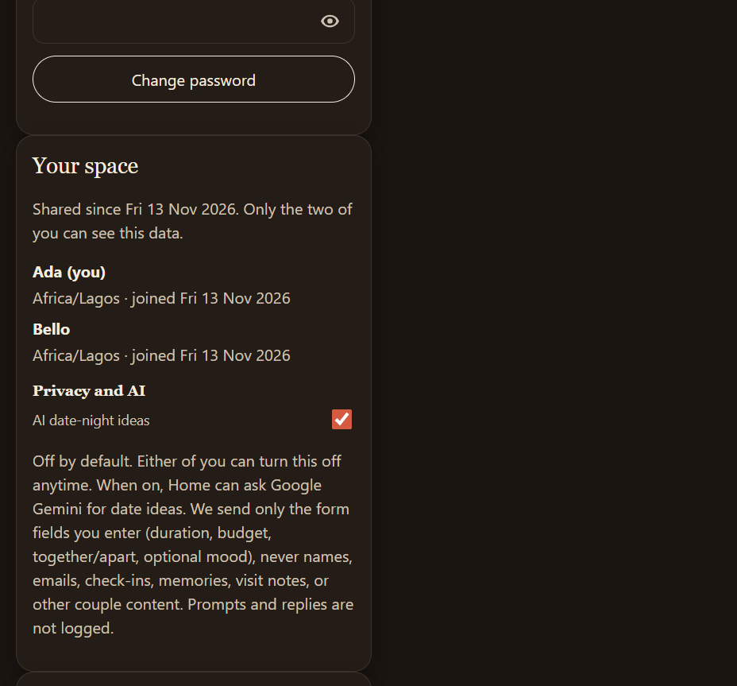

# Screenshots

Real UI from a running local stack (not mockups). Mobile viewport ~390×844.

## How to capture

1. Start the app (see [demo.md](../demo.md) or the README “Run it locally” section).
2. Register two allowlisted emails (or leave `REGISTRATION_ALLOWED_EMAILS` empty for open local register).
3. Pair via invite, add a visit and a check-in so Home / Visits / Check-in look inhabited. Enable AI in Settings if you want date ideas on Home.
4. Capture at ~390×844 (phone) or desktop width as needed.
5. Save PNGs here with the names below, then link them from the root README Screenshots section.

Optional helper (against a live Vite :5173 + API :8000 stack, not mock mode):

```bash
cd frontend
npx playwright test -c playwright.screenshots.config.ts
```

## Files

| File | Screen |
|---|---|
| `home.png` | Home (countdown + partner cards; date ideas when AI is on) |
| `calendar.png` | Calendar month |
| `visits.png` | Visits list / card |
| `check-in.png` | Check-in (prompt + both today) |
| `memories.png` | Memory timeline |
| `login.png` | Auth / branding (optional) |
| `settings.png` | Settings — Privacy and AI disclosure (optional) |














